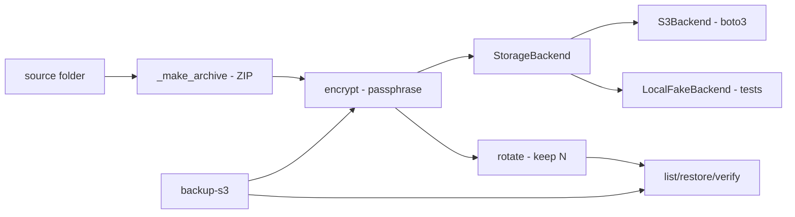

# backup-remoto-s3-criptografado

**English** · [Português (Brasil)](README.md)

[](#) [](#) [](#) [](#) [](LICENSE)

## What it is

**Local backup → remote storage with client-side encryption**: it zips a folder, encrypts the package (its own crypto with passphrase-derived keys), uploads to **S3** (boto3) or to a **local fake backend** (training/tests without AWS), **rotates** old backups (`--keep`) and **verifies integrity** on restore. Tests use **moto** (a simulated S3). It is an educational secure-backup lab.

## Status

An educational lab, working and tested (36 tests).

## Features

- **Cryptography** (`crypto.py`): `encrypt`/`decrypt` with passphrase-based key derivation (random salt); `EncryptedPackage` wraps salt+data; `CryptoError` on failures.
- **Backup** (`backup.py`): `BackupManager` — creates the ZIP (`_make_archive`), encrypts, uploads and records a `BackupInfo`; `IntegrityError` on verification failure.
- **Pluggable storage** (`storage.py`): the `StorageBackend` ABC with `S3Backend` (boto3) and `LocalFakeBackend`; `create_storage(backend="fake"|"s3")`.
- **Rotation** (`rotate --keep N`): keeps only the N most recent.
- **Verification** (`verify <id>`): hash checked at restore time.
- **CLI** (`cli.py`, prog `backup-s3`): `backup`, `list`, `restore`, `verify`, `rotate`.

## Architecture

A `backup_s3` package with separate layers: `backup` (orchestration), `crypto` (encryption), `storage` (pluggable transport). The fake backend mirrors the S3 interface, so the full suite runs without a network.



## Stack

- Python ≥ 3.10
- boto3 ≥ 1.28, cryptography ≥ 42.0
- moto + pytest (tests)

## Repository layout

```
backup-remoto-s3-criptografado/
├── pyproject.toml · BRIEF.md
├── src/backup_s3/
│   ├── backup.py   # BackupManager/zip/integrity
│   ├── crypto.py   # passphrase encryption
│   ├── storage.py  # S3Backend + LocalFakeBackend
│   └── cli.py · __main__.py
├── tests/          # 36 tests (moto: simulated S3)
└── LICENSE         # MIT
```

## Prerequisites and installation

```bash
pip install -e .
```

For real S3: AWS credentials in the environment (the same ones boto3 uses).

## How to run

```bash
# fake backend (training/local, no network)
backup-s3 backup ./data --backend fake --root .s3fake --passphrase "pass"
backup-s3 list --backend fake --root .s3fake
backup-s3 restore <id> ./restored --backend fake --root .s3fake --passphrase "pass"
backup-s3 verify <id> --backend fake --root .s3fake --passphrase "pass"
backup-s3 rotate --keep 3 --backend fake --root .s3fake
```
For production: swap `--backend fake` for `--backend s3 <bucket>`.

## Tests and quality

Real command (verified by the agent — moto installed):

```bash
PYTHONPATH=src python -m pytest tests/
# 36 passed
```

## Technical decisions and trade-offs

- **Pluggable backend (S3 or fake)**: the whole suite runs without AWS or a network.
- **Client-side encryption before upload**: storage never sees the data in the clear.
- **Hash verification on restore**: `verify` checks integrity before declaring success.

## Known limitations and roadmap

- Custom key derivation (educational) — for production, prefer audited schemes (age, restic, gpg).
- A full backup per run (no incremental).

## Development process

An individual project by Kelvin Oliveira, built with orchestrated AI agents and reviewed by the author.

## License and author

MIT — Copyright (c) 2026 Kelvin Rebelo de Oliveira. Author: [Kelvin Oliveira](https://github.com/KelvinOliveiraCode) · [Portfolio](https://kelvinoliveiracode.github.io/portfolio/)
