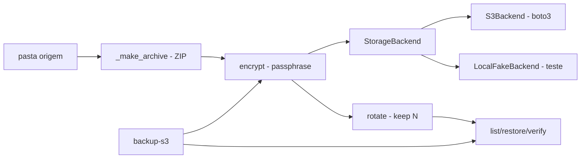

# backup-remoto-s3-criptografado

[English](README.en.md) · **Português (Brasil)**

[](#) [](#) [](#) [](#) [](LICENSE)

## O que é

**Backup local → armazenamento remoto com criptografia client-side**: compacta uma pasta em **ZIP**, cifra o pacote (crypto próprio com derivação de chave por passphrase), envia para **S3** (boto3) ou para um **backend fake local** (treino/testes sem AWS), **rotaciona** os backups antigos (`--keep`) e **verifica integridade** no restauro. Testes usam **moto** (S3 simulado). É um laboratório educacional de backup seguro.

## Status

Laboratório educacional funcional e testado (36 testes).

## Funcionalidades

- **Criptografia** (`crypto.py`): `encrypt`/`decrypt` com derivação de chave por passphrase (salt aleatório); `EncryptedPackage` empacota salt+dados; `CryptoError` em falhas.
- **Backup** (`backup.py`): `BackupManager` — cria o ZIP (`_make_archive`), cifra, envia e registra `BackupInfo`; `IntegrityError` na verificação.
- **Armazenamento plugável** (`storage.py`): `StorageBackend` (ABC) com `S3Backend` (boto3) e `LocalFakeBackend`; `create_storage(backend="fake"|"s3")`.
- **Rotação** (`rotate --keep N`): mantém apenas os N mais recentes.
- **Verificação** (`verify <id>`): hash conferido no restauro.
- **CLI** (`cli.py`, prog `backup-s3`): `backup`, `list`, `restore`, `verify`, `rotate`.

## Arquitetura

Pacote `backup_s3` com camadas separadas: `backup` (orquestra), `crypto` (cifra), `storage` (transporte plugável). O backend fake mantém a mesma interface do S3, o que permite testes completos sem rede.



## Stack

- Python ≥ 3.10
- boto3 ≥ 1.28, cryptography ≥ 42.0
- moto + pytest (testes)

## Estrutura do repositório

```
backup-remoto-s3-criptografado/
├── pyproject.toml · BRIEF.md
├── src/backup_s3/
│   ├── backup.py   # BackupManager/zip/integridade
│   ├── crypto.py   # cifração por passphrase
│   ├── storage.py  # S3Backend + LocalFakeBackend
│   └── cli.py · __main__.py
├── tests/          # 36 testes (moto: S3 simulado)
└── LICENSE         # MIT
```

## Pré-requisitos e instalação

```bash
pip install -e .
```

Para o S3 real: credenciais AWS no ambiente (as mesmas do boto3).

## Como executar

```bash
# backend fake (treino/local, sem rede)
backup-s3 backup ./dados --backend fake --root .s3fake --passphrase "senha"
backup-s3 list --backend fake --root .s3fake
backup-s3 restore <id> ./restaurado --backend fake --root .s3fake --passphrase "senha"
backup-s3 verify <id> --backend fake --root .s3fake --passphrase "senha"
backup-s3 rotate --keep 3 --backend fake --root .s3fake
```
Para produção: troque `--backend fake` por `--backend s3 <bucket>`.

## Testes e qualidade

Comando real (verificado pelo agente — moto instalado):

```bash
PYTHONPATH=src python -m pytest tests/
# 36 passed
```

## Decisões técnicas e trade-offs

- **Backend plugável (S3 ou fake)**: toda a suite roda sem AWS nem rede.
- **Cifração client-side antes do upload**: o armazenamento nunca vê os dados em claro.
- **Verificação de hash no restauro**: o `verify` confere a integridade antes de declarar OK.

## Limitações conhecidas e roadmap

- Derivação de chave própria (educacional) — para produção, prefira esquemas auditados (age, restic, gpg).
- Backup completo por execução (sem incremental).

## Processo de desenvolvimento

Projeto individual de Kelvin Oliveira, construído com agentes de IA orquestrados e revisado pelo autor.

## Licença e autor

MIT — Copyright (c) 2026 Kelvin Rebelo de Oliveira. Autor: [Kelvin Oliveira](https://github.com/KelvinOliveiraCode) · [Portfólio](https://kelvinoliveiracode.github.io/portfolio/)
